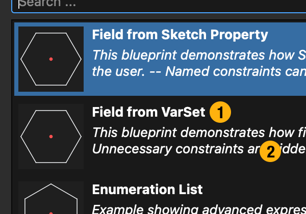
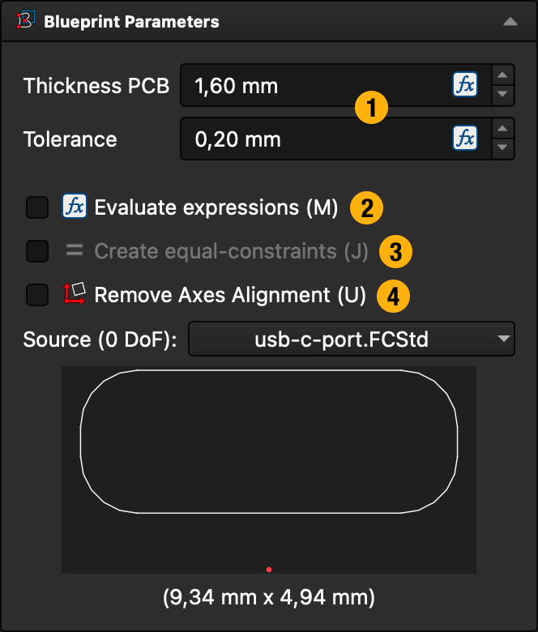

# Creating a Blueprint

This is a guide on creating new blueprints.
Refer to the provided example files if you are in doubt.

### Geometry

References on *external geometry* are prohibited.
You will be greeted with an error message if you try to do so.

Switch to the `Part` workbench to create a new sketch without a body (because `PartDesign` always creates a body)
=> smaller file size.

### Constraints

You should constraint your sketch to the *axis origin* because that is the single point of truth.
The origin is the point which will be constrained to existing geometry (if the user clicks on geometry).
You don't have to reference the origin specifically, just know that everything is imported relative to this point.

An *artificial axis* is created on insert.
You can freely use all constraints (e.g., symmetry) on both axes and origin in your sketch.
The addon will automatically replace references to the artificial axis when needed.

You are not required to *fully-constraint* your sketch, though it is highly recommended.
Any degree of freedom your blueprint has, means you'll need to fix an additonal DoF ... EVERY time you insert that blueprint.
Having said that, there may be cases where omitting a constraint is just more convenient.

Use *named constraints* to define multi-copy dependency (see [Sketcher insert options](#sketcher-insert-options), equal-constraints).

## Setting a name

There are two ways a blueprint can be loaded:

1. If the FreeCAD document contains only a single sketch, that sketch is loaded immediately.
2. If more than one sketch exists, Blueprints will show a "Blueprint Chooser" dialog:

This list shows all available sketches of the document.
- *Title* (1) is taken from the name of the sketch (its "Label" property)
- Optional: A *description* (2) is shown if you add this custom property to the sketch  
  => right-click "Add Property", Name: "desc", Type: `App::PropertyString`
- Optional: You can also add a *tooltip* to the `desc` property which will be shown if the user hovers over the row.

## Sketcher insert options

- You can add *customization parameters* (1) by using variables in your constraints.
  These can either come from a `VarSet` or from a property attached to the sketch (see hexagon example).
  There are quite a few types supported but if you need one which isn't supported yet, create an issue on GitHub.
- *Evaluate expressions* (2) is only available, if the blueprint contains at least one expression.
  If enabled, all expressions will be resolved to their plain values (better performance but poor editability).
- *Create equal-constraints* (3) is only available, if the blueprint contains at least one named (and driving) constraint.
  You can use named constraints to define equality between multiple copies.
  If this option is disabled, all named constraints are removed (the default).
  Else, the first inserted copy will retain its name and later copies will reference this named constraint.
- *Remove Axes Alignment* (4) just performs the same-named built-in Sketcher action.
  The quality of this operation depends on your blueprint constraints.
  For example, a horizontal / vertical constraint will either prohibit rotation, or will be replaced by a distance constraint.
  Depending on your design, at least one of the two will be wrong.

Tip: Variables can have *tooltips* too.
They are displayed if you hover over a field in (1).

### Note on over-engineering

You may be tempted to add a lot of options to your blueprints.
For example, wouldn't it be nice if the haxagon example had a parameter to choose if the pointy side or the flat side is up?
Please don't.
Remember that all the options will be inserted into the target sketch too.
So users will have a lot of "dead code" in their constraints.
Even if the options are not used, they are still computed each time the model tree needs to refresh.

Instead, create either multiple file or multiple sketches within a document.
... Or: you do you, but you have been warned.

Remember, users can still edit the sketch after it is imported.
Not everything has to be perfect.