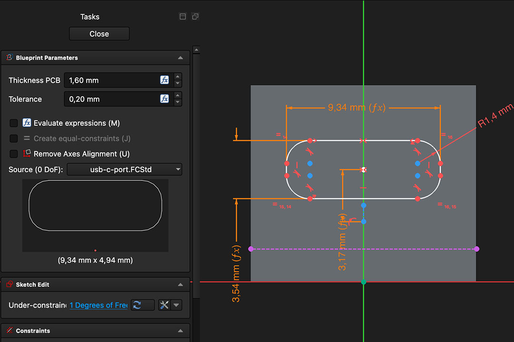
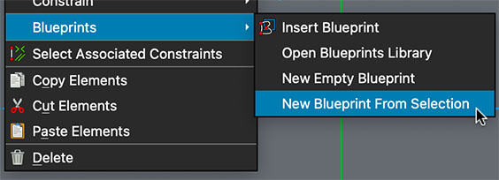
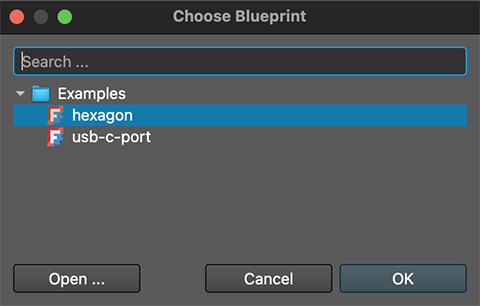
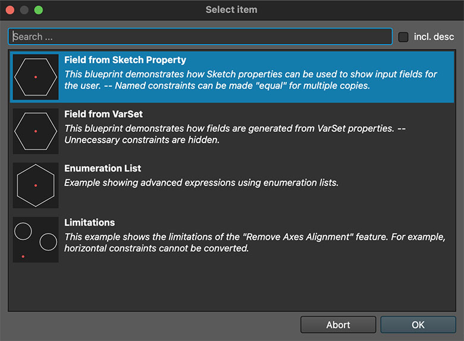

# Blueprints

Quickly insert complex sketches with a single click – variables & expressions included.
Reduce repetetive work by loading pre-defined sketches.

– See [GitHub](/README.md) for usage videos and [Creators Guide](/doc/README-Creators.md) on how to create your own.

For example, add a USB-C port (hole) to your electronics case in seconds:

### Features

- **Define your own blueprints** with tools you are already familiar with: FreeCAD.
- Use constraints, geometry, expressions – all are preserved
- Variables are exposed as configurable options (e.g., "Thickness PCB" and "Tolerance" above)
- Insert the same sketch multiple times
- Everything is inserted directly into your sketch - no addon required for reading the document.
- Blueprint documents can contain multiple templates:

---

